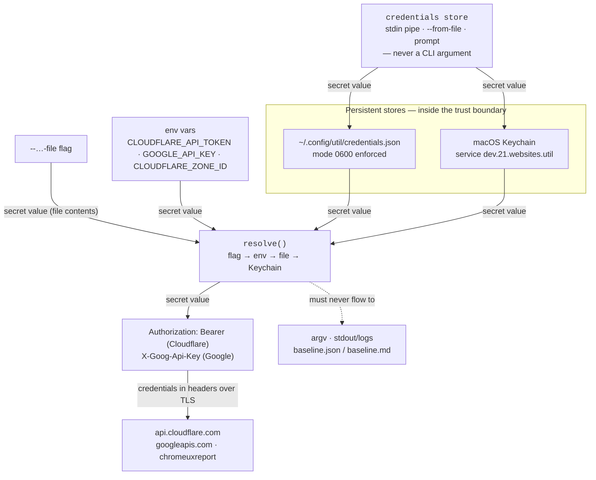

# Core Web Vitals baseline via synthetic + edge measurement

## Goal

Produce a recorded, reproducible performance baseline for `21.dev` and
`docs.21.dev` before CWV optimization work (Phase 3 Feature 3) and CI
performance budgets (Feature 8). This is the roadmap Now-tier item "CWV
field baseline" (ranked #4 in `Development/Research/roadmap-prioritization-2026-11.md`),
rescoped on measured reality: neither origin qualifies for CrUX field data
(traffic below the unpublished eligibility threshold — verified against the
public dataset, which renders both origins empty), Search Console's CWV
report has no API, and first-party/RUM JavaScript is ruled out (SC-005 —
the sites still serve DocC's JS bundle and a platform-injected Cloudflare
beacon today; `research.md` D2). The baseline therefore records
**synthetic (controlled-lab) measurements plus edge-measured timing**,
with the missing field data recorded as a first-class finding rather than
assumed.

## Approach

1. `util vitals baseline` collects, per site:
   - **Cloudflare Observatory** — trigger + poll `speed_api/pages/{url}/tests`
     per key page; reports Lighthouse lab metrics (LCP, CLS, FCP, SI, TBT,
     TTFB, performance score) for mobile and desktop in one test.
   - **PageSpeed Insights API** — `runPagespeed` per URL × mobile/desktop;
     same lab metrics from a second instrument (the same API Ahrefs Site
     Audit reads, keeping the two comparable side-by-side).
   - **CrUX API** — `records:queryRecord` per origin; an "insufficient
     data" response is the recorded field-data finding, not a failure.
   - **Edge TTFB** — `httpRequestsAdaptiveGroups` GraphQL
     (`edgeTimeToFirstByteMs` + `originResponseDurationMs` quantiles, 28-day
     window clamped to the dataset's plan limits) per host; the one
     vitals-adjacent metric observable at the edge. Degrades gracefully where the plan doesn't expose timing fields.
2. Credentials resolve flag → env → file (`~/.config/util/credentials.json`
   — file 0600, containing directory 0700) → macOS Keychain;
   `util vitals credentials store|show|delete`
   manages both stores. Secrets are never accepted as command-line values
   (shell history/process listing leak) — store reads from `--from-file`,
   piped stdin, or an interactive prompt.
3. Emits `baseline.json` (machine-readable, `schemaVersion`-stamped — schema
   in `contracts/`) and `baseline.md` (human-readable) into this spec
   directory: a dated observation, not a `budget.json`. The budgets feature
   (Phase 3 F8) derives the real threshold file from it later.
4. `--dry-run` emits the pending-structure artifacts with no network calls
   and refuses to overwrite a non-pending baseline — the CI-verifiable
   slice; the credentialed run is the maintainer step.
5. Page set: top N URLs per site from the generated `sitemap.xml`
   (default 10, `--max-pages`, `--url` overrides, `--site` restricts).
   Observatory one-off quota is plan-limited — N is deliberately small.

## Design

This spec handles secret material, so the diagram that exposes its real
risk is the credential data-flow — which paths a secret may take in, which
order it resolves out, and the sinks it must never reach:

The collection flow (CrUX probe → edge TTFB → Observatory + PSI per page →
artifacts) is prose-reviewable in `contracts/api.md`; its only subtlety is
that every source degrades to a *recorded* gap rather than a failure.

## Verification

- `nocorrect swift build` and `nocorrect swift test --filter Vitals` green.
- `nocorrect swift run util vitals baseline --dry-run` writes valid pending
  artifacts offline.
- Credentialed run (maintainer): `nocorrect swift run util vitals baseline`
  produces complete `baseline.json` + `baseline.md` for both sites.

## Test summary

- +~25 tests covering: request builders (Observatory REST, GraphQL, PSI,
  CrUX), response parsers (success + error + insufficient-data paths),
  credential resolution precedence (flag → env → file → Keychain), file
  store permission enforcement, and JSON/markdown report rendering.

## Tasks

- [ ] **Maintainer** — provision a Cloudflare API token (**Zone →
  Settings → Write** + **Zone → Analytics → Read** for the `21.dev` zone —
  `httpRequestsAdaptiveGroups` is zone-scoped, so Account-level Analytics
  does not cover it) and a Google API key (PageSpeed Insights API +
  Chrome UX Report API enabled). Exit: `nocorrect swift run util vitals
  credentials store` per secret, then `credentials show` reports all three
  keys as set (values masked).
- [ ] **Maintainer** — first live run. Exit: `nocorrect swift run util
  vitals baseline` exits 0 and `baseline.json` shows `status:
  complete|partial` covering both sites; commit the generated artifacts.
- [ ] **Maintainer** — paste the PSI key into Ahrefs Site Audit crawl
  settings for both projects and enable scheduled crawls. Exit: the date
  is recorded in `baseline.md`'s maintainer table.
- [ ] **Maintainer** — record the Search Console CWV report status for
  both properties in `baseline.md` (dashboard check, no API). Exit:
  `baseline.md`'s GSC rows are ticked with a date; quarterly recheck noted.
- [ ] Optional — create Observatory recurring schedules for key pages.
  Exit: `GET speed_api/availabilities` shows schedule quota consumed.
- [ ] Follow-on (Phase 3 F8) — derive `budget.json` thresholds from the
  baseline per the ratchet convention (observed values + headroom). Exit:
  a budget file exists in the F8 spec, not here.

## Companion files

- `spec.md` — numbered requirements (FR-NNN) and success criteria (SC-NNN).
- `research.md` — the evidence behind the synthetic + edge design.
- `contracts/api.md` — the four external API surfaces and their auth.
- `contracts/baseline-schema.md` — the `baseline.json` shape.
- `baseline.md` / `baseline.json` — the recorded observation (pending until
  the first credentialed run).
